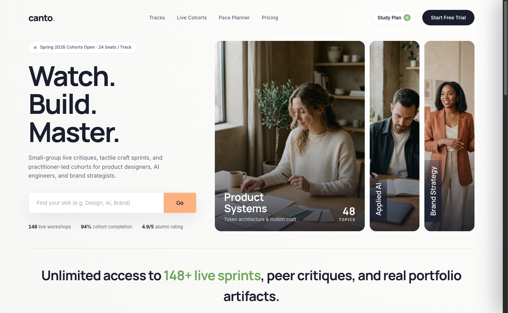
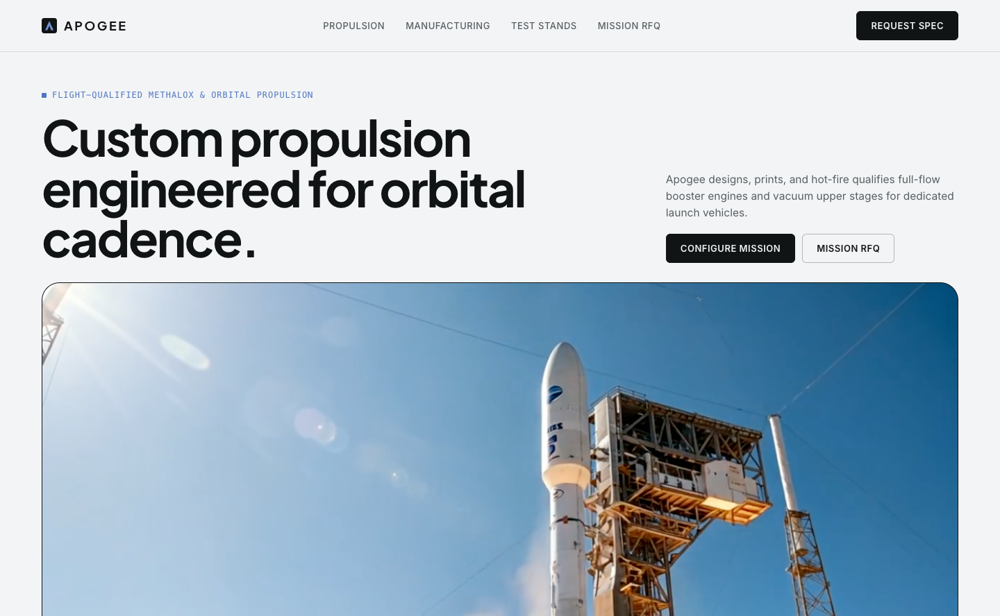
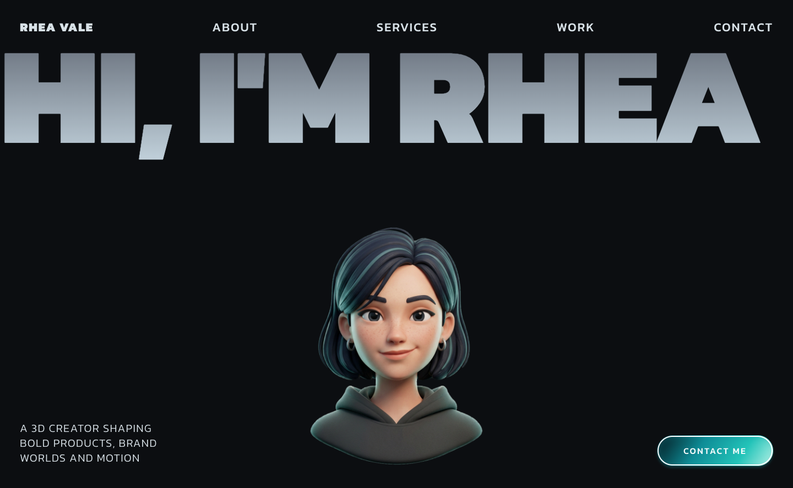
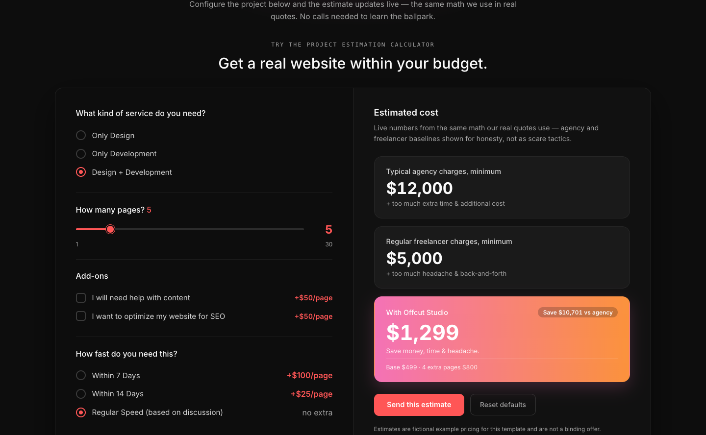
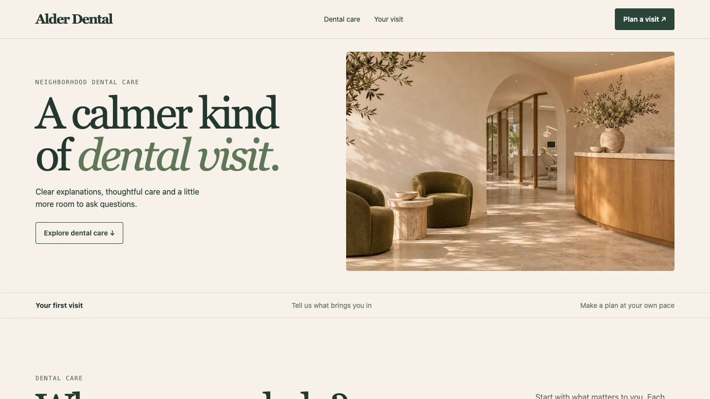

# Free AI Website Skills & Templates (Claude Code · Codex · Cursor)

[](https://workskill.tools)
[](https://workskill.tools/skills?access=free)
[](#quick-start)

> **Stop getting generic purple SaaS templates from your coding agent.**
> Every folder in this repo is a **complete, zero-dependency, production-grade website master** paired with a **`SKILL.md`** so **Claude Code**, **Codex**, **Cursor**, or **Antigravity** can reliably adapt the exact design, motion grammar, and interactive components to your brand.

- **100% Free & Offline-Ready** — Open any `index.html` directly in your browser (or `python3 -m http.server`). Zero build step, zero CDN links, local OFL fonts, MIT-licensed videos.
- **Real Native Interactions** — Calculators, configurators, filters, shopping bags, and honest local-demo forms.
- **Verified in Real Chrome** — Tested at desktop `1440×900` and mobile `390×844` with zero console errors and zero horizontal overflow.

---

## Included Free Website Skills (Full Source Inside This Repo)

| Preview | Skill & Industry | Signature Motion & Interactions | Links |
| :---: | --- | --- | --- |
|  | **[`canto`](./skills/canto/)** <br/> **Online Learning & Cohort SaaS** | Light-mode Scandinavian EdTech site with expanding 3-card vertical-label accordion hero, live course search, syllabus drawer & team tuition planner. | [Source](./skills/canto/) · [SKILL.md](./skills/canto/SKILL.md) · [Live Video Demo](https://workskill.tools/skills/canto) |
|  | **[`apogee`](./skills/apogee/)** <br/> **Aerospace Propulsion Engineering** | Scroll-expanding launchpad video hero, interactive Engine × Orbit × Payload mission configurator, tolerance accordion & Mission RFQ. | [Source](./skills/apogee/) · [SKILL.md](./skills/apogee/SKILL.md) · [Live Video Demo](https://workskill.tools/skills/apogee) |
|  | **[`rhea-vale`](./skills/rhea-vale/)** <br/> **3D Creator Portfolio** | Interactive 3D creator showcase, project detail viewer & responsive gallery choreography. | [Source](./skills/rhea-vale/) · [SKILL.md](./skills/rhea-vale/SKILL.md) · [Live Video Demo](https://workskill.tools/skills/rhea-vale) |
|  | **[`blomma`](./skills/blomma/)** <br/> **Botanical Fragrance Storefront** | Scent-note preference filter, bottle size pricing & interactive local shopping bag. | [Source](./skills/blomma/) · [SKILL.md](./skills/blomma/SKILL.md) · [Live Video Demo](https://workskill.tools/skills/blomma) |
|  | **[`offcut`](./skills/offcut/)** <br/> **Studio Price & Scope Calculator** | Live agency project scope configurator with real-time line-item quote & resettable state. | [Source](./skills/offcut/) · [SKILL.md](./skills/offcut/SKILL.md) · [Live Video Demo](https://workskill.tools/skills/offcut) |
|  | **[`alder-dental`](./skills/alder-dental/)** <br/> **Modern Dental Clinic Portal** | Warm editorial clinic landing page with treatment explorer, clinic hours & honest booking flow. | [Source](./skills/alder-dental/) · [SKILL.md](./skills/alder-dental/SKILL.md) · [Live Video Demo](https://workskill.tools/skills/alder-dental) |

---

## Quick Start

### 1. Preview any website locally (zero install)
```bash
git clone https://github.com/mailes/free-ai-website-skills.git
cd free-ai-website-skills/skills/apogee
python3 -m http.server 8080
# Open http://127.0.0.1:8080/
```

### 2. Use with Claude Code, Codex, or Cursor
Copy any skill folder (e.g. `skills/apogee`) into your project or `.agents/skills/` directory, then prompt your agent:

> *"Read `skills/apogee/SKILL.md` and adapt `skills/apogee/index.html` for my robotics hardware company **Kestrel Robotics** with our 3 actuators and custom telemetry specs."*

### 3. One-Command Agent Install (No Git Clone Needed)
You can also ask your AI agent to read the WorkSkill installer directly:
> *"Read https://workskill.tools/install/agent.md and install the free `apogee` skill."*

---

## Explore 490+ More Skills & Editable Templates on WorkSkill

Looking for more industries (Fintech, AI SaaS, Luxury Botanical, Real Estate, Cloud Infra, Motion Graphics & PPTX Decks)?

- **[Browse 60+ Free Skills on WorkSkill →](https://workskill.tools/skills?access=free)**
- **[KORSEN](https://workskill.tools/skills/korsen)** — Dark-Mode Automotive AI & ADAS Cockpit OS with 60fps Canvas Trajectory HUD
- **[ORIEL](https://workskill.tools/skills/oriel)** — Haute Joaillerie & 5-Axis Bespoke Diamond Ring Atelier with Salon Bag Drawer
- **[CORRID](https://workskill.tools/skills/corrid)** — Light-Mode Fintech & Live FX Corridor Calculator
- **[PARLEY](https://workskill.tools/skills/parley)** — Dark-Mode AI Meeting Notes SaaS with Live Canvas Waveform & `.md` Export
- **[VIREYA](https://workskill.tools/skills/vireya)** — Luxury Botanical Apothecary with 3D Elliptical Ingredient Orbit & Bag Drawer

---

## License

Original HTML/CSS/JS templates and `SKILL.md` workflows in this repository are released under the **MIT License**. Bundled fonts (SIL OFL 1.1) and media loops (MIT) are documented per file in each skill's `SOURCES.md`.

If these saved you hours of frontend prompting, consider giving this repo a ⭐!
